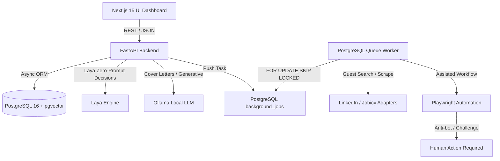

# System Architecture

## 1. High-Level Architecture

The AI Job Application Agent is structured as a modular, UI-first platform designed to assist candidates with precision application workflows.

## 2. Core Principles & Philosophy

1. **Quality over Quantity**: The system optimizes for highly targeted, customized applications that closely align with candidate skills and expectations, rather than blasting thousands of generic submissions.
2. **Strict Rule 2 Compliance**:
   - Zero fabrication of candidate details (experience, skills, salary, authorization).
   - Zero bypass of CAPTCHA, Cloudflare, or anti-bot protections.
   - Zero duplicate applications to the same job opening.
3. **No External Cache Dependency**: Redis and Celery are deliberately omitted in favor of PostgreSQL's native transaction isolation and `SELECT FOR UPDATE SKIP LOCKED` concurrency patterns.
